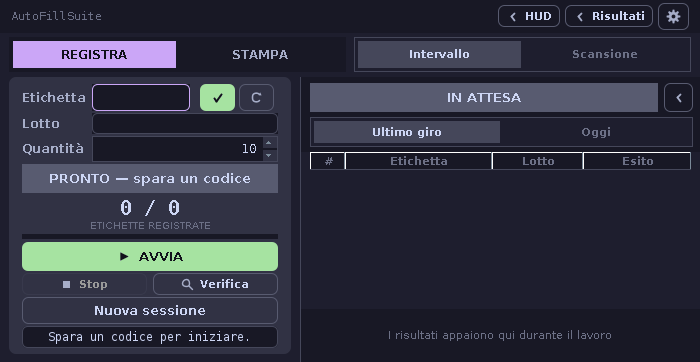
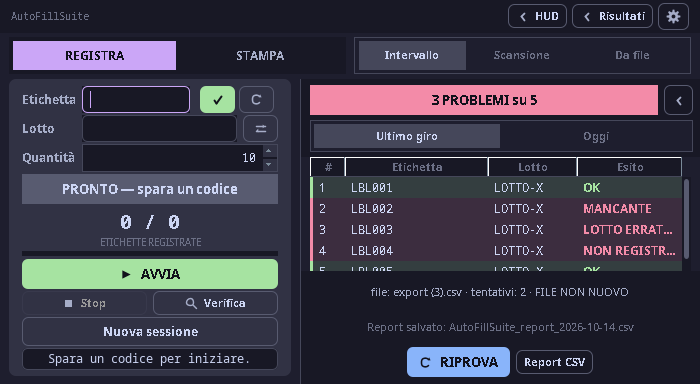
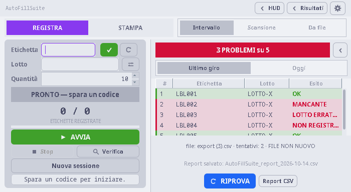

<div align="center">

# AutoFillSuite

A Java/Swing desktop tool for registering cable labels on a supplier portal
that has no API, then checking the result against the portal's CSV export.

[](https://github.com/importriri/AutoFillSuite/actions/workflows/tests.yml)
[](https://github.com/importriri/AutoFillSuite/actions/workflows/lint.yml)



</div>

## Why it exists

The portal accepts keyboard and mouse input but provides no API. AutoFillSuite
uses `java.awt.Robot` to perform the repetitive input, but it never treats the
keystrokes as proof. After a run, it downloads a fresh CSV export and compares
the portal's records with the labels that were attempted.

The tool is used on a production-floor Windows PC and remains a standalone Java
8 JAR with no runtime dependencies.

## Download

Every release ships two files:

- **`AutoFillSuite-windows.zip`** — extract the folder and open
  `AutoFillSuite.exe`. It carries its own trimmed Java runtime: no Java and no
  installation, so it runs on a locked-down PC without administrator rights.
  The executable is not signed: Windows SmartScreen may ask once ("More info",
  then "Run anyway"). Next to it, **`PREPARA-POSTAZIONE.bat`** sets up a
  workstation in seconds: portal address from the clipboard, Chrome and the
  print program found by themselves, AutoFillSuite started with Windows.
  `ANNULLA-POSTAZIONE.bat` undoes it.
- **`AutoFillSuite.jar`** — for a PC that already has Java 8 or newer.

The release workflow builds both: the JAR through `verify.sh`, then `jlink`
with only the modules the JAR uses and `jpackage --type app-image`. It runs on
a pushed tag `v1.2.3`, on a release published on GitHub (the files are added to
it), or from Actions > release > Run workflow with the version to publish.

## Workflows

Five modes: **Intervallo** (a range of labels), **Scansione** (scanned pairs),
**Da file** (files from a second line), **Stampa** (printing) and **Cancella**
(spoiled labels deleted from the portal). A second line
without a portal PC records its pairs with
[ScanLedger](https://github.com/importriri/ScanLedger) and exports them as CSV
files for the Da file mode.

### Range registration

Scan the first label, enter a quantity and choose the timing. The application
builds the serial range and sends one portal transaction per label.

### Queued QR scanning

Scan a label QR and a lot QR for each item. Valid pairs enter a queue and the
fields clear immediately, so scanning can continue while the worker sends short
bursts to the browser.

The queue supports continuous and block release. It rejects reversed scans,
malformed pairs, mismatches and unsafe duplicates before they are sent. In
block mode, queued rows can be selected, edited or removed before
`REGISTRA TUTTO`; once release starts, those rows become immutable.

Scanners configured with a TAB suffix are supported on QR 2 through the same
acceptance path as ENTER. TAB on QR 1 and Shift+TAB keep normal focus traversal.

### Files from a second line ("Da file")

A line without a portal PC records its pairs with ScanLedger (Registro QR on
screen) and exports a CSV in the format of
[`docs/CSV-FORMAT.md`](docs/CSV-FORMAT.md). This mode reads that file, checks
its fingerprint, the order of the day's exports and the portal's current
state, then registers it in verified blocks and can resume where it stopped.

### Deleting spoiled labels ("Cancella")

Spoiled labels are scanned into a list that is saved on disk, then deleted
from the portal after a countdown, with the mouse checked before every DELETE
click. An export afterwards checks that every deleted label is gone. A label
registered today asks before it can be listed.

### The day: one row per label, holes in the numbering

The results panel shows the day with one row per label, counted the way the
portal counts it (the last registration wins, deleted labels do not count),
and rebuilt from the daily report when the app reopens. Holes in the
numbering of each label type are listed in red; a hole of spoiled labels goes
to the Cancella list in one click.

### Printing helper

Some portal print forms ignore their quantity field and produce one label per
click. This mode keeps the portal quantity at one and performs the required
number of clicks with a configurable delay.

## Safety and recovery

- Moving the mouse stops the current robot operation; every lever pressed with
  the mouse counts down first, so the hand leaving it is not read as a move.
- The window is watched while the app is open: over a click target it turns
  red while the robot is still and steps aside between bursts while it works.
- One robot at a time: no mode starts while another one drives the mouse.
- A pair is returned to the queue only when the save action did not happen.
- The window checks that it is not covering one of its own click targets.
- Every attempted send is journaled before completion; the scan queue is
  written to disk before a pair shows in the table and comes back after a
  closed app or a power cut.
- An interrupted session can reopen with pending verification.
- Queued or uncovered rows cannot appear as verified.
- Retries request a new export instead of reusing a stale result.

The main cockpit and compact HUD use the same session state. Italian and English
operator manuals are embedded in the JAR and available from the settings view.

## Screenshots

| Mocha | Latte |
|---|---|
|  |  |

The screenshots and demo use the bundled offline test portal and synthetic
data. The compact HUD is shown in [`docs/screenshot-hud.png`](docs/screenshot-hud.png).

## Project layout

```text
src/app/core/      robot tasks, CSV watcher, verifier, reports and scan guards
src/app/ui/        cockpit, HUD, themes, tables and manual renderer
src/app/config/    settings and manual loading
src/app/docs/      Italian and English manuals embedded in the JAR
test/              plain-JDK test programs
test-site/         offline portal used for end-to-end exercises
```

The core package does not import the UI package. Background tasks report through
listeners and deliver UI callbacks on the Swing event thread. More detail is in
[`docs/ARCHITECTURE.md`](docs/ARCHITECTURE.md).

## Build and verify

Requirements: JDK 8 or newer, Ant and Xvfb for the display tests on Linux.

```bash
./verify.sh
ant jar
java -jar dist/AutoFillSuite.jar
```

`verify.sh` compiles for Java 8, runs the unit and display suites, builds the
standalone JAR, checks its manifest and embedded manuals, and starts the package
under Xvfb for a controlled smoke test.

The offline test portal is
[`test-site/lifecycle-test.html`](test-site/lifecycle-test.html). It keeps the
portal's interaction order and append-only CSV behavior but contains no portal
assets, production records or customer identifiers.

## Manuals

- [Italiano](src/app/docs/MANUAL.it.md)
- [English](src/app/docs/MANUAL.en.md)

## License

MIT
